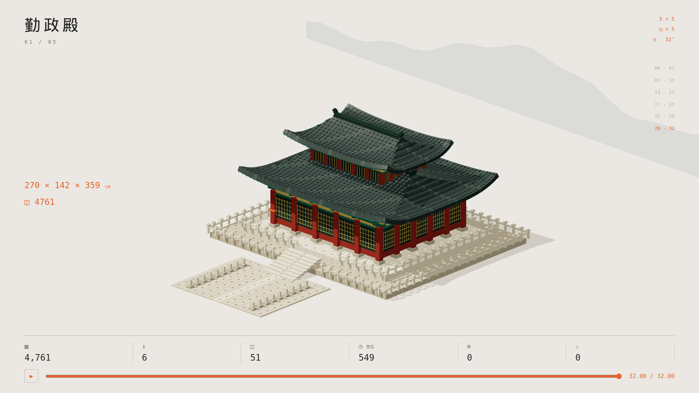
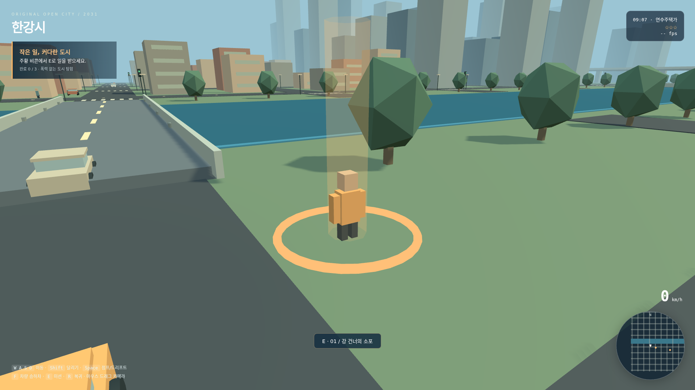
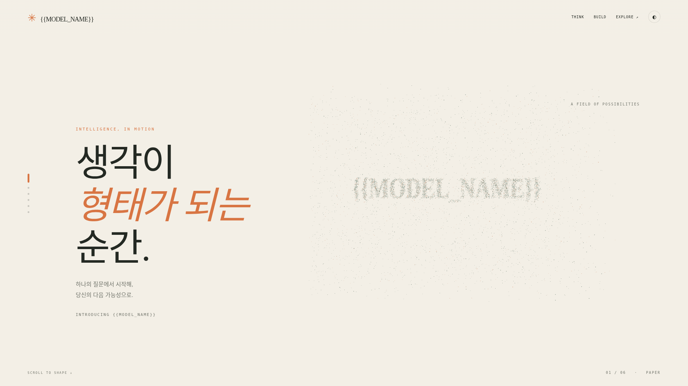

# Instinct Benchmarks | 인스팅트 벤치마크

Instinct가 같은 다섯 과제를 구현한 결과를 기록하는 저장소입니다. 추후 다른 에이전트·모델이 별도 저장소에서 수행한 결과와 비교할 수 있도록 원문과 실행 방법, 검증 범위, 후속 수정 여부를 구분합니다. 공식 성능 순위나 통제 실험 점수가 아닙니다.

[웹에서 결과 바로 보기](https://sigco3111.github.io/instinct-benchmarks/) · [USB OBS 컨트롤러 3D](https://sigco3111.github.io/instinct-benchmarks/1-controller-3d.html)

## 비교 기록

| 항목 | 이 저장소 |
|---|---|
| 실행 주체 | Instinct |
| 과제 출처 | 유튜버 코드팩토리의 메타프롬프트 (사용자 제공) |
| 세부 모델명·effort | 미지정. 임의로 추정하지 않음 |
| 평가 기준 | 기능 충족·화면 품질·재현성·검증 증거·미검증 항목 |
| 실행 성격 | 최초 구현 이후 사용자 피드백을 반영한 수정본. 단일 시도·동일 시간 제한 실험이 아님 |
| 후속 수정 | 2026-11-18 근정전 형태/브릭 모션 개선, 컨트롤러 직접 조작 3D 웹 추가 |

다른 실행은 원문 해시, 지정 모델·effort, 실행 날짜, 시간/비용 제한, 사용 조건, 수정 라운드와 검증 환경을 함께 기록해야 같은 조건인지 판단할 수 있습니다. 현재 값이 없는 항목은 점수나 완료로 채우지 않습니다. 원문은 `ORIGINAL_PROMPTS.txt`와 이 문서 하단에 그대로 보존합니다.

**메타프롬프트 출처: 유튜버 코드팩토리.** 모델 성능 비교를 위해 제안된 다섯 과제의 공통 입력입니다. 출처 이름은 사용자가 제공했고 원본 영상 링크는 확인되지 않았으며, 과제 원문은 맞춤법과 자리표시자를 고치지 않고 그대로 수록합니다.

## 결과물

| 과제 | 파일 | 현재 상태 |
|---|---|---|
| 경복궁 근정전 브릭 모션 | [palace.html](palace.html) | 32초 타임라인·임의 시점 탐색·브릭 집계 구현 |
| 한강시 3인칭 게임 | [hangang-city.html](hangang-city.html) | 걷기·차량·교통·미션 3종·수배·시간대 구현 |
| 모델 소개 스크롤 페이지 | [model-intro.html](model-intro.html) | 입자 모핑 6장면·테마·로컬 UI·모션 감소 구현 |
| 을지로 인쇄소 단편 | [웹 읽기](novel.html) · [원고](novel.md) | 제목·5장면 구성·본문 완성, 약 1.17만 자 |
| USB OBS 촬영 컨트롤러 | [3D 웹에서 바로 조작](https://sigco3111.github.io/instinct-benchmarks/1-controller-3d.html) | 설계·ARM 빌드·모의 USB/OBS·CAD 검증, 실물 미검증 |

컨트롤러는 압축을 풀지 않고 위 3D 웹 링크로 바로 확인합니다. 원본 설계 자료는 보존합니다.

## 실행

저장소를 다운로드한 뒤 각 HTML을 Chrome/Edge/Safari 등 최신 WebGL 지원 브라우저에서 여세요. 세 웹 과제는 각각 HTML 한 파일이며 3D 에셋을 내려받지 않습니다. Three.js 0.170.0, 소개 페이지의 GSAP/ScrollTrigger 3.12.5만 CDN에서 읽으므로 인터넷 연결이 필요합니다.

로컬 서버를 쓰려면:

```sh
python3 -m http.server 8000 --bind 127.0.0.1
```

그 뒤 `http://127.0.0.1:8000/`의 목차에서 실행할 수 있습니다. 별도의 계정이나 API 키는 필요 없습니다.

## 화면

### 01. 근정전


2026-11-18 고도화: 실제 생성된 브릭 4,761개를 월대 970, 기둥·창호 553, 공포 512, 지붕 2,580, 마당 146개로 집계합니다. 파트·형상·색상 기준 조립 유형은 51개입니다. 창호 격자, 상층 벽체, 단청 띠, 곡선 처마와 끊기지 않는 지붕면을 다시 만들었습니다.

32초 동안 개별 블록이 회전하며 날아가 층별로 다시 결합하고, 결합부 색상 파동·지붕 분리·기둥 보강·같은 브릭들의 인벤토리 변환·재조립으로 이어집니다. 슬라이더로 앞뒤로 이동할 수 있습니다. 치수는 코드 모델의 경계상자이며 실제 궁궐 실측 도면 수치가 아닙니다. 연결부 보강 경고는 디지털 조립 연출이지 구조 강도 검사가 아닙니다. 정지 화면의 0 카운터 혼동과 화면 크기 변경 후 캔버스가 비는 문제도 수정했습니다.

건축 형태 참고: [국가유산 디지털 서비스의 근정전 설명](https://digital.khs.go.kr/heri/heriDetail.do?ctptUid=13898859666526200071). 외부 3D 모델이나 유료 에셋은 사용하지 않았습니다.

### 02. 한강시


조작과 구현 구조, 다섯 줄:
1. W/A/S/D 이동, Shift 달리기, Space 점프. 마우스 드래그로 추적 시점을 돌립니다.
2. 차량 옆에서 F로 승하차, W/S 가속·후진, A/D 조향, Space 관성 드리프트.
3. 주황 비콘에서 E로 배달·추적 회피·옥상 레이스를 시작하며 R로 강변 시작점에 복귀합니다.
4. 시드 기반 도시, 두 교량, 고가도로, 인스턴싱·원거리 창문 LOD·거리 컬링·경계상자 충돌을 사용합니다.
5. 신호 대기 AI, 순찰차/수배 1~3, 미니맵, 속도계, 180초 낮·노을·밤 순환이 있습니다. 폭력·피해·공격 묘사는 없습니다.

### 03. 생각이 형태가 되는 순간


모델명은 `{{MODEL_NAME}}` 그대로입니다. 1M은 연출 개념값으로 표시하며 모델 지원 한도라고 주장하지 않습니다. 실제 추론 점수와 에이전트 지원 범위는 미지정입니다. 질문 폼은 외부 전송 없는 로컬 UI 데모입니다.

## 04. 역상(逆像)

[소설 전체 읽기](novel.html) · [구성과 분량](NOVEL_README.md) · [원고 검증](NOVEL_VERIFICATION.md)

2031년 폐업을 앞둔 을지로 활판 인쇄공 문 씨에게 도착하는 마지막 주문. 제목과 다섯 장면 구성에 이어 본문을 끝까지 수록했습니다. 주문자의 정체를 단정하지 않고 인쇄된 한 장으로 마칩니다.

## 05. USB OBS 촬영 컨트롤러

[3D 컨트롤러 열기](https://sigco3111.github.io/instinct-benchmarks/1-controller-3d.html)

- 드래그/터치로 3D 회전, 휠로 확대·축소. 키보드 방향키와 +/-도 지원합니다.
- 입체/상단/정면 프리셋, 케이스 열기, 자동 회전, 시점 초기화.
- 0~12초 타임라인과 조립/분해 버튼. CAD에서 내보낸 케이스 메시와 단순 부품 외형을 사용합니다.
- 모의 REC·장면 전환·연결 끊기/복구, OLED 상태·경과 시간·빨간 표시등. 실제 USB/OBS를 제어하지 않습니다.
- 한 HTML에 메시와 한글 서브셋 폰트를 포함해 별도 CDN·설치·ZIP 없이 실행합니다. WebGL 지원 브라우저가 필요합니다.

[조립·플래시·실행](HARDWARE_README.md), [기존 하드웨어 검증](HARDWARE_VERIFICATION.md), [공식 출처](HARDWARE_SOURCES.md)를 함께 보세요. 이전 설계 소스 ZIP과 고정 시점 미리보기는 이력 자료로 보존했습니다. 현재 주 결과는 직접 조작하는 3D 웹입니다. CAD·펌웨어를 이번 화면 개선으로 새로 검증했다고 주장하지 않습니다. 실제 제작·전류·포트 공차·실제 OBS 연동은 미검증입니다.

2026-11-18 3D 웹 검사: Chrome/SwiftShader, 1920×1080 및 390×844. 드래그 회전, 휠 확대, 분해 탐색, 케이스 열기, 상단 시점, REC, 장면 전환, 연결 끊김/복구, 타임라인 재생, 자동 회전, 모바일 가로 넘침 없음의 12개 검사 통과. JavaScript 페이지 오류 0건. 60fps·실물 동작을 입증하는 검사는 아닙니다.

## 검증과 한계

[WEB_VERIFICATION.md](WEB_VERIFICATION.md)와 [web-checks.json](web-checks.json)에 실행한 검사를 기록했습니다. 게임 기능 검사는 위치·시간 테스트 훅을 사용한 디지털 검사이며 전체 미션 수동 완주를 대신하지 않습니다. 60fps는 목표이며 모든 기기에서 보장한 실측 결과가 아닙니다. 모델 수치, 물리 강도, 실물 제작, OBS 실제 연동 성공을 지어내지 않습니다.

`{{MODEL_NAME}}`, `{{EFFORT}}`는 지정받지 않은 원문 자리표시자입니다. 미지정 값을 임의의 실제 모델명이나 성능 수치로 바꾸지 않았습니다.

## 원문 메타프롬프트

유튜버 코드팩토리가 제안한 모델 성능 비교용 메타프롬프트의 전체 원문입니다. 맞춤법과 자리표시자(`{{MODEL_NAME}}`, `{{EFFORT}}`, `{{TASK_DIR}}`)를 고치지 않고 그대로 수록하며, [별도 원문 텍스트](ORIGINAL_PROMPTS.txt)에도 같은 내용을 보존합니다.

최초 요청 원문:

> 다음은 모델의 성능 밴치를 위한 메타프롬프트야. 이 5가지를 만들어서 저장소에 생성해줘. 리드미에 메타 프롬프트도 포한시켜줘
>
> 출처는 코드팩토리 라는 유튜버야

```text
궁전 모션 그래픽
three.js 한 페이지로 경복궁 근정전을 브릭(스터드 달린 블록) 모델로 직접 설계하고, 그 모델을 해부하는 32초 모션을 만들어줘. 외부 3D 파일 없이 코드로 짓는다.

건축 고증: 2단 월대와 돌난간, 중층 팔작지붕(처마 곡선·추녀 솟음), 단청(녹청·주홍·황), 정면 5칸 측면 5칸, 앞마당 품계석 두 줄, 뒤로 인왕산 실루엣. 모든 브릭은 파트별 그룹(월대/기둥/공포/지붕/마당)으로 나누고 개수를 실제로 센다.

연출: 크림 지면 #F2EEE6, 액센트는 주황 #E8612C 한 색. 아이소메트릭 카메라 고정, 하드 컷 없이 모델 하나가 형태만 바꾼다.
0–7s 주황 바운딩 박스를 선으로 그리고 실측 치수(cm) 카운트업 → 층별 수직 분해 후 재조립
7–13s 와이어프레임 전환, 결합부 하이라이트가 아래에서 위로 주황→파랑
13–17s 모노톤 복귀, 지붕만 남기고 나머지 20% → 지시선 + 브릭 수
17–23s 기둥 하나 클로즈업: 약한 결합부 경고 → 보강 → 0 ✓
23–29s 부품 인벤토리 격자 스태거 등장
29–32s 하단 통계 6칸(브릭·단계·파트·생성시간·에러·경고) 카운트업

숫자는 전부 코드가 실제로 센 값만 쓴다. 문장 없이 숫자와 아이콘만. 1920×1080, 시간 슬라이더로 아무 프레임이나 찾아갈 수 있게.
한강시 게임
브라우저에서 바로 도는 3인칭 오픈월드 액션 게임을 three.js 단일 HTML로 만들어줘. 장르 문법은 GTA식이지만 이름·로고·캐릭터·에셋은 전부 오리지널.

무대: 서울을 닮은 가상 도시 '한강시'. 강 하나, 다리 둘, 고층 업무지구, 골목 주택가, 고가도로, 편의점과 네온 간판(한글). 절차적으로 생성하되 블록마다 성격이 다르게.

플레이:

걷기/달리기/점프, 차량에 다가가 F로 탑승·하차
차량은 가속·드리프트·충돌 반동, 신호를 지키는 AI 차량과 보행자
미션 3개: 배달(시간 제한), 추격 따돌리기, 옥상 체크포인트 레이스
수배 레벨 1~3: 올라가면 순찰차가 추적, 숨으면 내려간다
미니맵, 속도계, 낮→노을→밤 순환, 밤엔 가로등과 네온이 켜진다
품질: 60fps 유지(인스턴싱·LOD·거리 컬링), 카메라는 충돌 회피하는 3인칭 추적, 조작감이 제일 중요하다. 폭력 묘사는 넣지 않는다.

끝나면 조작키와 구현 구조를 5줄로 요약해줘.
소개 페이지
'{{MODEL_NAME}}'를 소개하는 단일 페이지 사이트를 만들어줘. 목표는 스크롤 한 번 한 번이 놀라운, 올해 본 가장 화려한 랜딩이다. HTML·CSS·JS 한 파일, 라이브러리는 CDN(three.js, GSAP ScrollTrigger)만.

컨셉: '생각이 형태가 되는 순간'. 스크롤하면 하나의 입자 구름이 계속 모양을 바꾸며 이야기를 끌고 간다(끊기는 섹션 전환 없음).

히어로: 커서를 따라 휘는 입자장 위로 '{{MODEL_NAME}}'가 입자에서 조립된다
추론: 입자가 가지를 치는 사고 트리로 자라며 경로 하나가 빛난다
코딩: 입자가 코드 줄로 흘러내려 실제로 돌아가는 작은 UI를 짓는다
긴 맥락: 책 수천 페이지가 한 점으로 빨려 들어가는 1M 컨텍스트 연출
에이전트: 여러 작업 노드가 동시에 돌고 합쳐지는 오케스트레이션
엔딩: 모든 입자가 모여 큰 입력창이 되고 '{{MODEL_NAME}}에게 물어보기'
디자인: 따뜻한 오프화이트와 깊은 먹색 두 테마, 액센트 한 색, 세리프 헤드라인 + 모노 라벨. 한국어 카피는 짧게.
성능 수치·벤치마크는 지어내지 말고 자리표시자로 둔다. 모바일에서도 60fps, prefers-reduced-motion 존중.
소설
한국어 단편 소설을 써줘. 분량 원고지 60매 안팎(약 1만 2천 자).

설정: 2031년 서울, 폐업을 앞둔 을지로 인쇄소. 70대 활판 인쇄공 '문 씨'가 마지막 주문을 받는다. 주문자는 얼굴을 보인 적 없는 사람으로, 매일 밤 한 문장씩 원고를 보내온다. 문장들은 문 씨가 40년 전 잃어버린 누군가의 말투를 닮아 간다.

요구:

3인칭 제한 시점, 문 씨 곁에 붙어서 간다
활자를 고르고 조판하는 손의 감각을 구체적으로(납 냄새, 역상으로 읽는 글자, 잉크 번짐)
주문자의 정체는 끝까지 한 문장으로 확정하지 말고, 독자가 스스로 도달하게
대사는 적게, 을지로 골목의 소리와 계절(늦가을→첫눈)로 시간을 흐르게
감상적인 설명 금지. 슬픔은 행동과 사물로만 보여준다
마지막 장면은 인쇄된 한 장의 종이로 끝낸다
먼저 제목과 다섯 장면의 구성을 짧게 제시하고, 이어서 본문을 끝까지 쓴다. 문장은 단정하고 리듬감 있게, 한국 문학 단편의 밀도로.
기판
촬영용 AI 데스크 컨트롤러 한 대를 설계하고, 실제 제작에 넘길 수 있는 파일과 동작 코드를 끝까지 만들어줘. 이번에는 창작자가 실제로 쓸 촬영 컨트롤러를 독립적으로 만든다.

작업 폴더: {{TASK_DIR}}
이 폴더만 수정한다. 다른 리뷰 4개 과제는 별도로 실행 중이니 접근하거나 변경하지 않는다.

제품: 책상 위 작은 USB 촬영 컨트롤러. 물리 버튼으로 녹화 시작/중지, 촬영 중 빨간 표시등, 작은 화면에 촬영 경과 시간과 연결 상태, 장면 전환 버튼. USB 연결을 기본으로 하고 OBS Studio를 제어하는 현실적인 방식을 선택한다. 표시등은 단순히 버튼이 눌렸다는 뜻이 아니라 가능하면 OBS의 실제 녹화 상태를 반영한다. 통신이 끊기면 상태를 명시한다. USB 저전압 기기로 설계하고 무선·배터리·상용전원 회로는 제외한다.

우선 기성 MCU 개발보드를 사용하는 조립 가능한 프로토타입을 만든다. 부품은 현재 구할 수 있는 제품으로 선택하고 제조사 공식 문서와 실제 핀맵·전압·치수·라이브러리 호환성을 확인한다. 개발보드/주변부품의 정확한 변형을 고정한다. 컴퓨터 쪽 브리지 앱이 필요하면 함께 구현한다. 연결/재연결, 버튼 디바운스, 중복 명령, 녹화 상태 동기화를 처리한다. 준비된 프로그램이 실제로 컴파일되는지 가능한 도구로 검증하고, 하드웨어 없이는 확인할 수 없는 항목을 구분한다.

납품물:

REQUIREMENTS.md, ARCHITECTURE.md, 공식 출처 링크를 포함한 BOM.csv와 배선표. 전원 예산과 USB 전류 요구를 근거와 함께 설명.
firmware/ 전체 소스와 재현 가능한 빌드 설정, 필요한 경우 host/ 브리지 앱 및 실행 안내. 인증정보를 파일에 넣지 않는다.
enclosure/ 편집 가능한 파라메트릭 CAD 원본과 STL. 제조사 치수에 근거해 포트·버튼·화면·지지대·나사·공차를 설계. 치수 가정을 명시하고 간섭 여부를 가능한 범위에서 점검.
실제 핀 연결을 표현한 가독성 있는 회로도 또는 배선도. PCB가 꼭 필요하면 편집 가능한 설계 파일을 추가하되 검증 없는 제조 준비 완료 판정은 하지 않는다. 단순한 그림을 전기 CAD 파일이라고 부르지 않는다.
preview/ 로컬에서 실행 가능한 시각화. 설계와 일치하는 케이스 조립/분해·기판 배치·버튼과 화면의 동작을 보여준다. 시뮬레이션인 부분을 명시한다. 1920x1080 영상으로 캡처하기 좋은 화면과 시간 슬라이더가 있으면 좋다. 핵심 설계·코드 완성 후 만든다.
README.md의 조립/플래시/실행 절차, VERIFICATION.md의 실행한 검증과 로그·제한, 실제 기기 인수 테스트 목록. 구매·제작업체 발주·유료 생성·배포·커밋은 하지 않는다. 실물 제작과 테스트를 했다고 꾸미지 않는다.
가장 먼저 부품과 통신 구조를 정하고 파일을 만들기 시작해라. 계획 제시만으로 종료하지 말고 설계·구현·빌드·디지털 검증을 마친 뒤 최종 파일 경로와 남은 실물 검증 사항을 보고해줘. 선택된 {{MODEL_NAME}} {{EFFORT}}를 유지해라.
```
